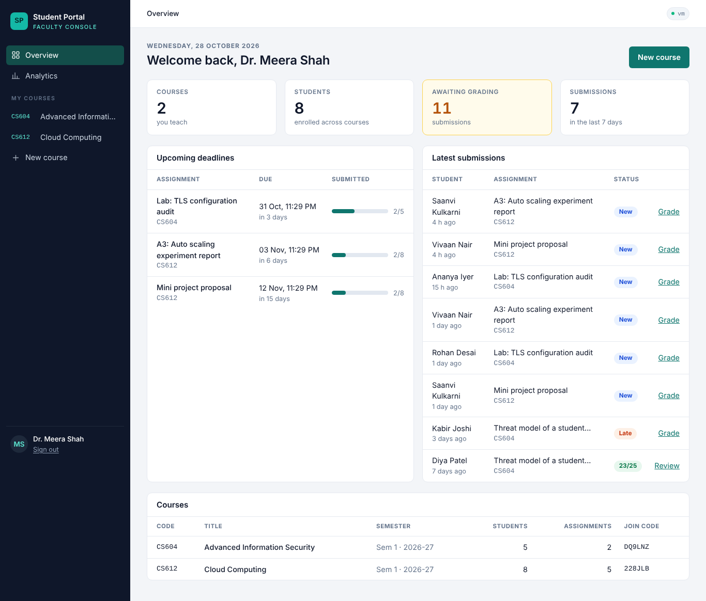
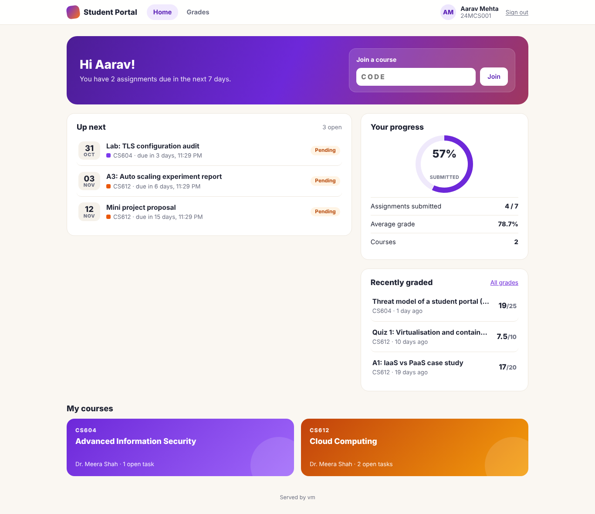
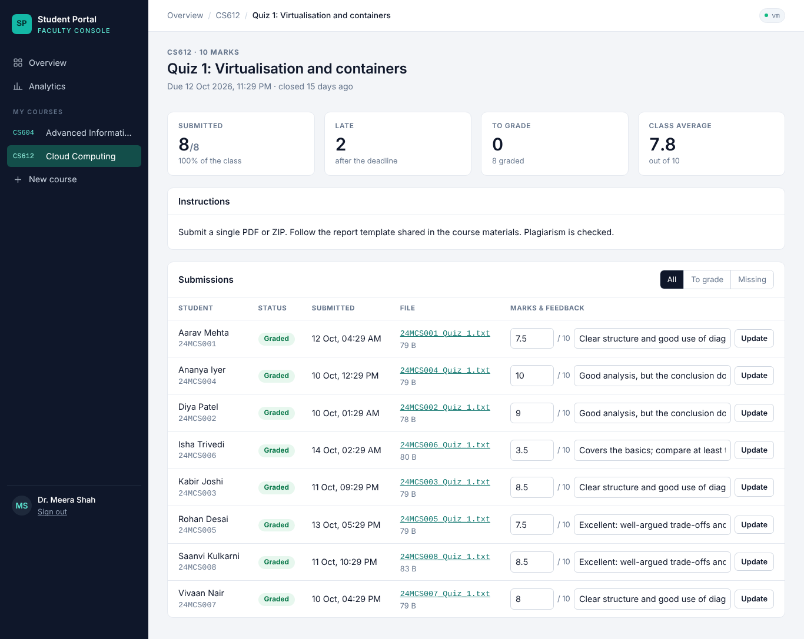
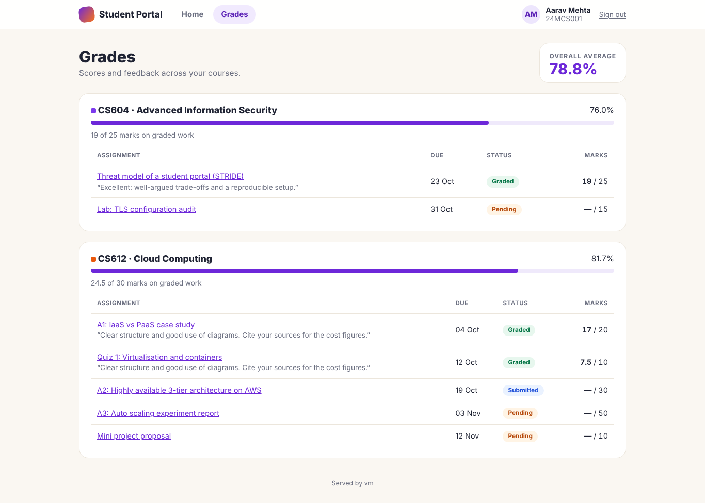
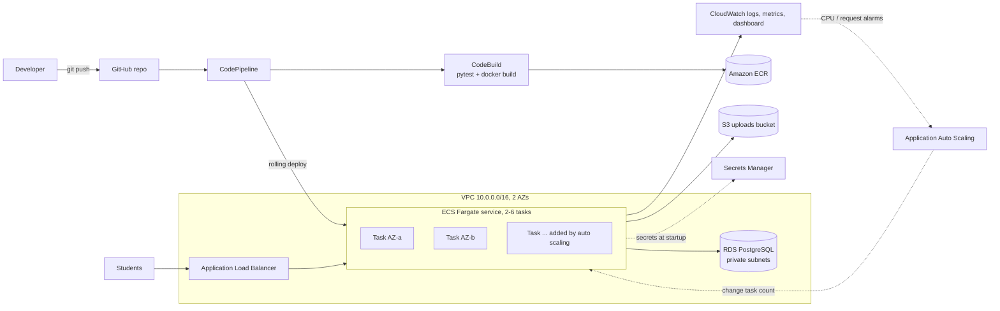

# Student Portal on AWS: Role-Based Course-Work System with CI/CD, Load Balancing & Auto Scaling

A course-work portal with **separate workspaces for faculty and students**, deployed as a
cloud-native application on AWS.

| Faculty Console (`/teacher`) | Student Hub (`/student`) |
|---|---|
| Create courses; students enrol with a 6-character join code | Join courses with the code from class |
| Share lecture materials (stored in S3) | Download materials and assignment briefs |
| Publish assignments with deadlines, marks and a brief | See what's due next, with countdowns |
| Grade submissions with marks and feedback | Submit or resubmit work until it's graded; late work is flagged |
| Analytics: submission rate, on-time %, grade distribution, students needing support | Progress ring, average grade, per-course grades with feedback |
| Export the gradebook as CSV | |

Both roles share one sign-in and land in their own interface: a dense, sidebar-based console
for faculty and a card-based hub for students. Faculty signup requires a department access code.

| Faculty Console | Student Hub |
|---|---|
|  |  |
|  |  |

More in [`docs/screenshots/`](docs/screenshots/).

**Cloud features demonstrated**

- **CI/CD**: every `git push` → 33 automated tests → Docker build → zero-downtime rolling deploy with automatic rollback
- **Load balancing**: an Application Load Balancer spreading traffic across containers in 2 Availability Zones
- **Auto scaling**: ECS adds containers (2 → 6) when CPU or requests rise, and removes them when load drops
- **Infrastructure as Code**: 3 CloudFormation templates create (and delete) everything
- **Security**: private DB subnets, least-privilege IAM, Secrets Manager, encrypted private S3, CSRF, audit log

**Project documentation** (in `docs/`)

| Document | Contents |
|---|---|
| [architecture.md](docs/architecture.md) | Objectives, deployment and logical views, ER diagram, access-control matrix, request lifecycle |
| [design-decisions.md](docs/design-decisions.md) | 9 architecture decision records with alternatives and trade-offs |
| [threat-model.md](docs/threat-model.md) | STRIDE analysis: 18 threats, mitigations, residual risk |
| [test-plan.md](docs/test-plan.md) | Requirement-to-test traceability and the acceptance checklist |
| [experiments.md](docs/experiments.md) | Elasticity, deployment-availability and fault-tolerance experiments with result tables |

---

## 1. Architecture



### AWS services used and why

| Service | Role in this project |
|---|---|
| **ECS on Fargate** | Runs the Docker containers without managing servers |
| **Application Load Balancer** | Single public URL; health checks; spreads requests across tasks |
| **Application Auto Scaling** | Target tracking on CPU (50%) and requests per task (1000/min); min 2, max 6 |
| **RDS PostgreSQL** | Users, courses, enrolments, assignments, submissions, grades, audit log; private subnets |
| **S3** | Uploaded files; private, encrypted, HTTPS-only; downloads via 5-minute presigned URLs |
| **Secrets Manager** | Generated DB password, Flask secret key and faculty access code, injected into containers |
| **ECR** | Private Docker image registry, scans images on push |
| **CodePipeline / CodeBuild** | Source → Build (tests + image) → Deploy |
| **CloudWatch** | Container logs, Container Insights, a ready-made dashboard |
| **IAM** | Separate least-privilege roles for ECS, the app, CodeBuild and CodePipeline |
| **VPC** | 2 public subnets (ALB + tasks), 2 private subnets (DB), layered security groups |
| **CloudFormation** | Creates and deletes all of the above |

**Security groups are chained:** Internet → ALB (port 80) → app tasks (port 5000, only from the ALB) → RDS (port 5432, only from the app). The database can never be reached from the internet.

**Why sessions work across many containers:** Flask stores the login session in a signed cookie, and every task reads the *same* `SECRET_KEY` from Secrets Manager. So any task can serve any user, which is what makes horizontal scaling and load balancing work without sticky sessions.

---

## 2. Project layout

```
student-portal/
├── app/
│   ├── __init__.py           app factory, error pages, template filters
│   ├── config.py             12-factor config from env vars (RDS, S3, secrets)
│   ├── models.py             User(role), Course, Enrollment, Material, Assignment, Submission, AuditLog
│   ├── auth.py               landing, signup (student / faculty), login, logout
│   ├── teacher.py            Faculty Console: courses, materials, assignments, grading, CSV, analytics
│   ├── student.py            Student Hub: join, deadlines, submissions, grades
│   ├── files.py              downloads with per-object authorization
│   ├── ops.py                /health, /health/db, /api/server, /load
│   ├── storage.py            S3 (cloud) or local folder (dev)
│   ├── uploads.py            upload validation
│   ├── security.py           audit log, client IP, safe redirects
│   ├── logging_setup.py      JSON logs, request IDs, security headers
│   ├── cli.py                `flask seed-demo` (demo semester)
│   ├── templates/
│   │   ├── layouts/          public.html, teacher.html, student.html  (three distinct shells)
│   │   ├── auth/  teacher/  student/  errors/  partials/
│   └── static/css/           base.css + public.css, teacher.css, student.css
├── tests/                    33 pytest tests (run in the pipeline)
├── docs/                     architecture, ADRs, threat model, test plan, experiments
├── Dockerfile                multi-stage: base → test → runtime
├── docker-compose.yml        local run with PostgreSQL
├── buildspec.yml             CodeBuild instructions
├── infra/
│   ├── 00-ecr.yaml           stack 1: image registry
│   ├── 01-infra.yaml         stack 2: VPC, ALB, ECS, auto scaling, RDS, S3, secrets, dashboard
│   └── 02-pipeline.yaml      stack 3: CodePipeline + CodeBuild
├── scripts/
│   ├── deploy-infra.sh       creates stacks 1 and 2
│   ├── deploy-pipeline.sh    creates stack 3
│   ├── seed-demo.sh          loads demo data on AWS (one-off ECS task)
│   ├── get-faculty-code.sh   prints the faculty access code
│   ├── show-load-balancing.sh
│   └── teardown.sh           deletes everything
├── loadtest/locustfile.py    load test to trigger auto scaling
└── .github/workflows/ci.yml  optional: run tests on pull requests
```

---

## 3. Prerequisites (one-time)

1. **AWS account.** Do not use the root user. In IAM create a user (or IAM Identity Center user) with `AdministratorAccess` for this project, and create an access key for CLI use.
2. **Install tools** on your laptop:
   - [AWS CLI v2](https://docs.aws.amazon.com/cli/latest/userguide/getting-started-install.html)
   - [Docker Desktop](https://www.docker.com/products/docker-desktop/)
   - Git, and Python 3.11+ (only needed to run tests or Locust locally)
   - **Windows:** run the `.sh` scripts from **Git Bash** or **WSL**.
3. **Configure the CLI:**
   ```bash
   aws configure
   # Access key, secret key, region: ap-south-1, output: json
   aws sts get-caller-identity     # should print your account ID
   ```
4. **Set a budget alert** (Billing → Budgets → create a $10 monthly budget with email alerts). Strongly recommended.

> Region: scripts default to **ap-south-1 (Mumbai)**. To use another region: `export AWS_REGION=us-east-1` before running them.

---

## 4. Run it locally first (optional, 2 minutes)

```bash
# Option A: plain Python (SQLite + local uploads folder)
python -m venv .venv && source .venv/bin/activate      # Windows: .venv\Scripts\activate
pip install -r requirements.txt -r requirements-dev.txt
python -m pytest -q                                     # 33 passed
flask --app wsgi seed-demo                              # optional: demo faculty, students, grades
python wsgi.py                                          # http://localhost:5000

# Option B: Docker with PostgreSQL, closer to AWS
docker compose up --build                               # http://localhost:5000
docker compose exec web flask seed-demo                 # optional demo data
```

Locally, the faculty access code is `FACULTY-DEV`.

---

## 5. Push the code to GitHub

```bash
cd student-portal
git init
git add .
git commit -m "Student Portal: initial commit"
git branch -M main
# Create an empty repo on github.com first (no README), then:
git remote add origin https://github.com/<your-username>/student-portal.git
git push -u origin main
```

---

## 6. Deploy the infrastructure (stacks 1 and 2)

```bash
chmod +x scripts/*.sh
./scripts/deploy-infra.sh
```

What the script does:

1. Creates the **ECR repository** (`infra/00-ecr.yaml`).
2. Builds the Docker image on your machine and pushes it as `:bootstrap`. (ECS needs an image to exist before the service can start.)
3. Creates **everything else** (`infra/01-infra.yaml`): VPC, subnets, security groups, ALB, ECS cluster + service (2 tasks), auto scaling policies, RDS, S3, secrets, log group, dashboard.

Takes **about 15 minutes** (RDS is the slow part). At the end it prints:

```
Done. Your app:      http://student-portal-alb-123456789.ap-south-1.elb.amazonaws.com
```

### Load the demo semester (recommended before a presentation)

```bash
./scripts/seed-demo.sh          # runs `flask seed-demo` as a one-off ECS task
./scripts/get-faculty-code.sh   # prints the faculty access code for creating real teacher accounts
```

| Role | Email | Password |
|---|---|---|
| Faculty (CS612, CS604) | `meera.shah@demo.portal` | `Demo@2026` |
| Faculty (IT621) | `arvind.rao@demo.portal` | `Demo@2026` |
| Student | `aarav.24mcs001@demo.portal` | `Demo@2026` |
| Student (struggling, appears in analytics) | `isha.24mcs006@demo.portal` | `Demo@2026` |

The demo includes 3 courses, 8 M.Tech students, 9 assignments, materials, on-time and late
submissions, grades with feedback, and one student flagged for support. Uploaded files appear in
S3 under `courses/<course_id>/...`. The demo accounts share a public password, so delete the
stack (or the accounts) after your presentation.

<details>
<summary>Prefer the AWS Console over scripts?</summary>

CloudFormation → **Create stack** → *Upload a template file*:
1. `infra/00-ecr.yaml`, stack name `student-portal-ecr`.
2. Push the image manually (ECR → repository → **View push commands**, tag it `bootstrap`).
3. `infra/01-infra.yaml`, stack name `student-portal-infra`, tick *"I acknowledge that AWS CloudFormation might create IAM resources"*.
4. The **Outputs** tab shows `AppUrl`.
</details>

---

## 7. Connect GitHub to AWS (one-time, in the console)

CodePipeline needs permission to read your repo. This step must be done in the browser:

1. AWS Console → **Developer Tools** → **Settings** → **Connections** → **Create connection**.
2. Provider **GitHub**, name `student-portal-github` → **Connect to GitHub**.
3. Authorize **AWS Connector for GitHub** and install the app on your account (you can limit it to the `student-portal` repo).
4. Back in AWS, the connection status must say **Available**. Copy its **ARN**
   (`arn:aws:codeconnections:ap-south-1:123456789012:connection/...`).

---

## 8. Deploy the CI/CD pipeline (stack 3)

```bash
./scripts/deploy-pipeline.sh <connection-arn> <your-username>/student-portal main
```

The pipeline starts immediately. Open the printed pipeline URL and watch the three stages:

| Stage | What happens |
|---|---|
| **Source** | Pulls the latest commit from GitHub `main` |
| **Build** | CodeBuild runs `buildspec.yml`: builds the Docker `test` stage (runs pytest; **a failing test stops the pipeline**), builds the runtime image, tags it with the commit hash, pushes to ECR, writes `imagedefinitions.json` |
| **Deploy** | ECS registers a new task-definition revision and does a **rolling update**: new tasks start, pass ALB health checks, then old tasks drain. If new tasks keep failing, the **deployment circuit breaker rolls back** automatically |

---

## 9. Demo script (for your viva / presentation)

### A. The application: two roles
1. Sign in as **`meera.shah@demo.portal`** to open the Faculty Console. Walk through the overview KPIs, open **CS612**, show the join code, the **Students** tab, then an assignment: filter **To grade**, enter marks and feedback, and save. Open **Analytics** (grade distribution, students needing support) and download the **Gradebook CSV**.
2. In a private window, sign in as **`aarav.24mcs001@demo.portal`** to open the Student Hub. Show **Up next**, open an assignment and submit a file, then open **Grades** to see the feedback Dr. Shah just wrote.
3. While signed in as the student, open `/teacher/`. You get **403**: role isolation.

### B. CI/CD in action
1. Edit `app/templates/auth/landing.html`, e.g. change the heading.
2. `git commit -am "Update landing heading" && git push`
3. Show CodePipeline moving through Source → Build → Deploy (~5–7 min). Open the Build logs to show the **33 tests** passing.
4. Show ECS → cluster → service → **Deployments** tab: new revision rolling out with no downtime.
5. Refresh the site: the new heading appears.

**Bonus, failed build:** break a test (e.g. change `== 200` to `== 201` in `test_health_endpoints`), push, and show the Build stage failing while the live site stays untouched. Revert and push again.

### C. Load balancing
```bash
./scripts/show-load-balancing.sh
```
Each line shows a different `task_id` / `az`: the ALB is alternating between containers in two Availability Zones. The Faculty Console's top-right badge (and the Student Hub footer) also shows which task served the page. In the console: EC2 → **Target Groups** → *Targets* tab shows the healthy task IPs.

PowerShell alternative:
```powershell
1..20 | % { (Invoke-RestMethod "http://<alb-dns>/api/server").task_id }
```

### D. Auto scaling under load
1. Open the CloudWatch dashboard (URL printed by the deploy script) and ECS → service → **Events** tab.
2. Start the load test from your laptop:
   ```bash
   pip install locust
   locust -f loadtest/locustfile.py --host http://<alb-dns> --headless -u 150 -r 10 -t 12m
   ```
   (Or run `locust ...` without `--headless` and use the web UI at http://localhost:8089.)
3. Within ~3–5 minutes CPU goes above 50%. The service events show messages like
   *"has started 2 tasks"* and the **Running tasks** graph climbs from 2 toward 6.
4. Stop the load test. After ~10–15 minutes of low CPU, scale-in removes tasks back to 2.
   (Scale-in is deliberately slower than scale-out to avoid flapping.)

Explain the policy: **target tracking** keeps average CPU near 50%. CloudWatch alarms created by Application Auto Scaling trigger the changes. Min 2 tasks for high availability, max 6 to cap cost.

Record the numbers in the tables in **docs/experiments.md**.

### E. Self-healing
ECS → cluster → Tasks → select one → **Stop**. The ALB stops sending it traffic, and ECS starts a replacement automatically because the service wants at least 2 running tasks.

### F. Security talking points
- DB in private subnets with no internet route; security groups allow only ALB → app → DB.
- No passwords in code or Git: Secrets Manager generates them; ECS injects them at startup.
- App IAM role can only touch its own bucket (least privilege).
- S3 bucket is private, encrypted, and denies non-HTTPS access; downloads use 5-minute presigned URLs.
- Two-layer authorization: role guard on every faculty/student route plus ownership/enrolment checks on every object (404 for others' data). All tested.
- Faculty signup gated by an access code from Secrets Manager; every grade change, export and failed login is audit-logged.
- Passwords hashed (scrypt), CSRF tokens on every form, open-redirect protection, CSV formula-injection guard, security headers.
- Full STRIDE analysis in `docs/threat-model.md`.
- ECR scans every image for CVEs on push.

---

## 10. Useful commands

```bash
# Live application logs
aws logs tail /ecs/student-portal --follow

# Current number of running tasks
aws ecs describe-services --cluster student-portal-cluster --services student-portal-service \
  --query "services[0].{desired:desiredCount,running:runningCount}"

# Scaling activity history
aws application-autoscaling describe-scaling-activities --service-namespace ecs \
  --query "ScalingActivities[0:5].[StartTime,Description]" --output table

# Check DB connectivity from the app
curl http://<alb-dns>/health/db

# Faculty access code
./scripts/get-faculty-code.sh
```

---

## 11. Cost and teardown

Rough cost while running in Mumbai: **about $1.5–2.5 per day** (ALB, 2 small Fargate tasks, RDS `db.t4g.micro`, public IPv4 addresses, Container Insights). RDS may be covered if your account is in the Free Tier. Figures are approximate; check the AWS Pricing Calculator for your account.

No NAT Gateway is used (that alone would add ~$1+/day): tasks sit in public subnets with public IPs, but their security group accepts traffic **only from the ALB**.

**When you're done, delete everything:**
```bash
./scripts/teardown.sh
```

---

## 12. Troubleshooting

| Symptom | Fix |
|---|---|
| `503 Service Temporarily Unavailable` right after deploy | Tasks are still starting or passing health checks; wait 1–2 minutes |
| Tasks keep stopping | ECS → Tasks → stopped task → *Stopped reason*; then `aws logs tail /ecs/student-portal` |
| `exec format error` in logs | Image built for ARM (Apple Silicon). The script uses `--platform linux/amd64`; rebuild with it |
| Pipeline Source stage fails | GitHub connection is not **Available**, or the repo name/branch is wrong |
| CodeBuild `toomanyrequests` from Docker Hub | The Dockerfile already pulls from `public.ecr.aws`; keep it that way |
| `/health/db` returns 503 | Check the RDS instance is *Available* and the DB security group allows the app SG |
| Stack stuck in `UPDATE_ROLLBACK_FAILED` | CloudFormation → stack → **Continue update rollback** |
| Upgrading an earlier deployment of this project fails with database column errors | The schema changed (roles, courses). Run `./scripts/teardown.sh`, then deploy fresh (see ADR-007) |
| Re-running `deploy-infra.sh` reverts the image | CloudFormation sets the task definition to `ImageTag`. After the pipeline exists, push a commit to redeploy the latest image |

---

## 13. Ideas to extend it (extra marks)

- **HTTPS**: request an ACM certificate for your domain, add a 443 listener, redirect 80 → 443, set `COOKIE_SECURE=true`.
- **Route 53** custom domain pointing to the ALB.
- **AWS WAF** on the ALB (managed rules for SQL injection, XSS, rate limiting).
- **Amazon Cognito** with the institute's SSO, mapping directory groups to the faculty/student roles.
- **Amazon SES** email notifications for new assignments, deadline reminders and released grades.
- **CloudFront** in front of the ALB for caching and static assets.
- **RDS Multi-AZ** (`MultiAZ: true`) for database high availability.
- **Manual approval** stage in CodePipeline before production deploys.
- **Blue/green deployments** with CodeDeploy instead of rolling updates.
- **Alembic** (Flask-Migrate) migrations run as a one-off ECS task before the deploy stage.
- **Plagiarism check** as an asynchronous job (S3 event → SQS → worker service) to show event-driven scaling.
