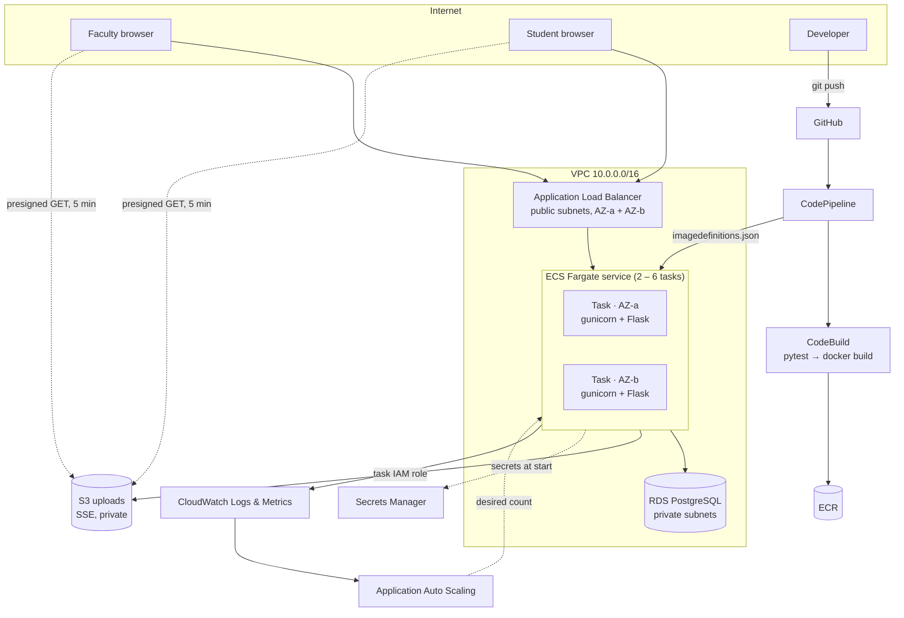

# System Architecture

## 1. Problem statement

Course work in many departments is spread across email, messaging groups and shared drives.
Faculty cannot easily see who has submitted, deadlines are missed without anyone noticing, and
there is no record of grade changes. **Student Portal** is a role-based course-work system for
faculty and students. It is deployed as a cloud-native application on AWS to demonstrate
continuous delivery, horizontal scalability and high availability.

### Objectives

| # | Objective | How it is met |
|---|---|---|
| O1 | Separate, least-privilege workspaces for faculty and students | Role-guarded blueprints, object-level authorization (§4) |
| O2 | Durable, private file storage | Amazon S3 with SSE, public access blocked, presigned downloads |
| O3 | Zero-touch, zero-downtime delivery | CodePipeline → CodeBuild → ECS rolling deploy with circuit breaker |
| O4 | Elastic capacity under load | ECS Service Auto Scaling, target tracking on CPU and ALB requests |
| O5 | No single point of failure in the web tier | ≥ 2 tasks across 2 Availability Zones behind an ALB |
| O6 | Observability | JSON logs, CloudWatch dashboard, Container Insights, audit log |

## 2. Deployment view



### Network segmentation

| Layer | Subnets | Inbound allowed from | Route to internet |
|---|---|---|---|
| ALB | public A/B | `0.0.0.0/0 : 80` | yes |
| App tasks | public A/B (public IP, no NAT cost) | ALB security group `: 5000` only | yes (to reach ECR/S3/Secrets Manager) |
| Database | private A/B | App security group `: 5432` only | **none** |

The tasks are technically in public subnets to avoid a NAT Gateway (≈ USD 32/month), but their
security group admits traffic **only** from the load balancer, so they are not reachable directly.
Production would place them in private subnets behind a NAT Gateway or VPC endpoints (see ADR-004).

## 3. Logical view

```
app/
├── __init__.py       application factory, error pages, template filters
├── config.py         12-factor configuration from environment variables
├── extensions.py     SQLAlchemy, LoginManager, CSRFProtect
├── models.py         domain model (below)
├── auth.py           landing, signup (role + faculty code), login, logout
├── teacher.py        Faculty Console  /teacher/*
├── student.py        Student Hub      /student/*
├── files.py          downloads with per-object authorization  /files/*
├── ops.py            /health, /health/db, /api/server, /load
├── storage.py        S3 ⇄ local filesystem abstraction
├── uploads.py        upload validation (extension allow-list, size, empty files)
├── security.py       audit trail, client IP, safe redirects
├── logging_setup.py  JSON logs, request IDs, security headers
├── timeutil.py       UTC storage / Asia/Kolkata presentation
└── cli.py            `flask seed-demo`
```

### Domain model (ER)

```mermaid
erDiagram
  USERS ||--o{ COURSES : teaches
  USERS ||--o{ ENROLLMENTS : has
  COURSES ||--o{ ENROLLMENTS : has
  COURSES ||--o{ MATERIALS : shares
  COURSES ||--o{ ASSIGNMENTS : publishes
  ASSIGNMENTS ||--o{ SUBMISSIONS : receives
  USERS ||--o{ SUBMISSIONS : makes
  USERS ||--o{ AUDIT_LOG : performs

  USERS { int id PK; string email UK; string role; string roll_number UK; string password_hash }
  COURSES { int id PK; string code; string title; string join_code UK; int teacher_id FK }
  ENROLLMENTS { int id PK; int course_id FK; int student_id FK }
  MATERIALS { int id PK; int course_id FK; string storage_key UK }
  ASSIGNMENTS { int id PK; int course_id FK; datetime due_at; int max_marks; string attachment_key }
  SUBMISSIONS { int id PK; int assignment_id FK; int student_id FK; string storage_key UK; float marks; text feedback }
  AUDIT_LOG { int id PK; int user_id FK; string action; string ip; datetime created_at }
```

Constraints enforced by the database: unique `(course_id, student_id)` enrolment, unique
`(assignment_id, student_id)` submission, unique join codes, unique emails and roll numbers.

### S3 object layout

```
courses/<course_id>/materials/<uuid>/<file>
courses/<course_id>/assignments/<assignment_id>/brief/<uuid>/<file>
courses/<course_id>/assignments/<assignment_id>/submissions/<student_id>/<uuid>/<file>
```
The random UUID segment makes keys unguessable and prevents overwrites; the prefix hierarchy
allows per-course lifecycle rules or exports later.

## 4. Access control model

| Resource | Faculty (owner of course) | Faculty (other) | Student (enrolled) | Student (not enrolled) | Anonymous |
|---|---|---|---|---|---|
| `/teacher/*` | ✔ | ✔ (own data only) | 403 | 403 | → login |
| `/student/*` | 403 | 403 | ✔ | ✔ (own data only) | → login |
| Course, assignment, roster | ✔ | 404 | read | 404 | → login |
| Material / brief download | ✔ | 404 | ✔ | 404 | → login |
| Submission download | ✔ | 404 | own only | 404 | → login |
| Grade a submission | ✔ | 404 | — | — | — |

Two layers: a **blueprint-level guard** (`before_request`) checks the role for every route, and
**scoped lookups** (`_course`, `_assignment`, `_submission`) check ownership or enrolment for
every object. Unauthorized object access returns **404 rather than 403**, so IDs cannot be used
to discover what exists. Every rule in the table has an automated test (`tests/test_app.py`).

## 5. Request lifecycle

1. The ALB terminates the client connection, picks a healthy target (round robin), and adds
   `X-Forwarded-For` and `X-Amzn-Trace-Id`.
2. gunicorn (2 workers × 4 threads per task) hands the request to Flask.
3. `before_request`: request ID assigned (reuses the ALB trace ID), timer started; the blueprint
   guard checks the session and role.
4. The view runs; the session cookie is signed with `SECRET_KEY`, which is the **same for all
   tasks** (from Secrets Manager), so any task can serve any user and no sticky sessions are needed.
5. `after_request`: security headers added, one JSON log line emitted with path, status, latency,
   user and role.

## 6. Delivery pipeline

| Stage | Tool | Gate |
|---|---|---|
| Source | CodePipeline + CodeConnections (GitHub) | push to `main` |
| Build | CodeBuild, `buildspec.yml` | `docker build --target test` runs **33 pytest cases**; any failure stops the pipeline |
| Package | CodeBuild | image tagged with the commit SHA, pushed to ECR (scan on push) |
| Deploy | ECS deploy action | rolling update, `minimumHealthyPercent = 100`; ALB health checks gate traffic; **circuit breaker rolls back** a failing release |

Because the image is tagged with the commit SHA, every running task can be traced to an exact commit,
and rollbacks are deterministic.
